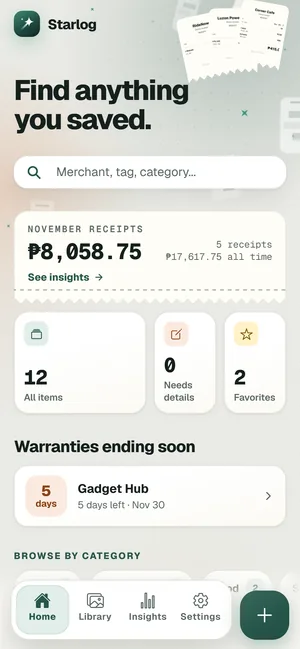
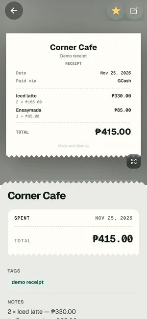
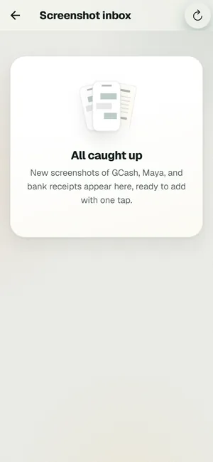
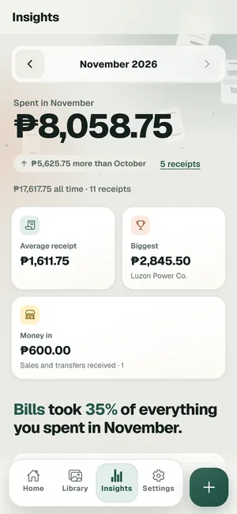
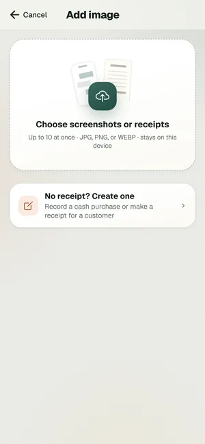
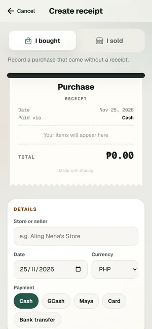
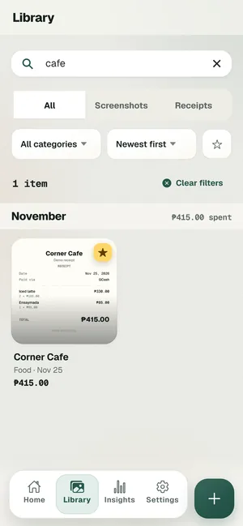
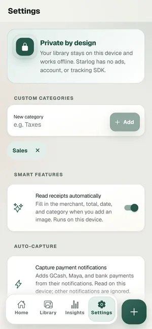

# Starlog

[](https://github.com/bitwindamountains/starlog/actions/workflows/ci.yml)

An offline-first receipt and screenshot organizer for Android and the web. Starlog reads receipts on the device, turns GCash, Maya and bank payment notifications into receipts, and shows where the money went. No account, and nothing is uploaded.

**[Try the web version →](https://starlog-receipts.netlify.app)** Choose **Explore with demo receipts** to look around with sample data.
**[Download the Android app (APK) →](https://github.com/bitwindamountains/starlog/releases/latest)** Version 0.4.5, signed.

<table>
  <tr>
    <td></td>
    <td></td>
    <td></td>
    <td></td>
  </tr>
  <tr>
    <td align="center">Home</td>
    <td align="center">A receipt, read on the device</td>
    <td align="center">Captured payments</td>
    <td align="center">Insights</td>
  </tr>
</table>

## Walkthrough

<table>
  <tr>
    <td width="25%"></td>
    <td width="25%"></td>
    <td width="25%"></td>
    <td width="25%"></td>
  </tr>
  <tr>
    <td valign="top"><b>1. Add images.</b> Choose up to ten screenshots or receipt photos at once, share them in from another app, or paste and drop them in the browser.</td>
    <td valign="top"><b>2. Record a purchase with no receipt.</b> The receipt maker builds one from items, payment method and date, with a live preview.</td>
    <td valign="top"><b>3. Find it later.</b> Search by merchant, tag, category or amount, and filter screenshots from receipts.</td>
    <td valign="top"><b>4. Stay in control.</b> Switch off automatic reading or notification capture, add categories, and back up or restore the library.</td>
  </tr>
</table>

## Features

- **Reads receipts on the device:** merchant, items, total and date, with ML Kit on Android and Tesseract in the browser
- **Auto-capture (opt-in):** payment notifications with a peso amount become receipts, new screenshots land in an inbox, and duplicates are skipped by reference number
- **Receipt maker** for cash purchases and sales
- **Library and search** with categories, tags and favorites
- **Insights:** monthly spending, comparison with last month, the biggest receipt and money received
- **Warranty reminders** with local notifications
- **Backup and restore** of the whole library
- **Undo on delete,** a guard against discarding half-filled forms, light and dark themes

## Privacy

Everything stays on the device. Metadata is stored in on-device SQLite and image copies in app-private storage on Android. In the browser, metadata uses localStorage and images use IndexedDB. Receipt reading runs locally, so images and text never leave the device. Don't add network SDKs or logging of sensitive data without a privacy and Google Play Data safety review.

## Tech stack

| Part | Technology |
| --- | --- |
| App | Angular 22, Ionic 9, TypeScript |
| Native | Capacitor 8 (Android), SQLite, ML Kit text recognition, local notifications, a custom capture plugin in Java |
| Web | The same app as a PWA (service worker), with Tesseract.js for reading receipts, hosted on Netlify |
| Tests | Vitest: 76 unit tests for the receipt and payment parsers, backup format, demo data, insights and stores |

## Run it locally

Requires Node 24.15+ and npm 11.

```bash
npm install
npm start          # browser version
npm run check      # typecheck, tests and build
```

To build the hosted web version, which includes the offline text-recognition files (about 15 MB on disk; a visitor downloads about 7 MB the first time a receipt is read):

```bash
npm run build:web
```

## Android

Install Android Studio with its bundled JDK, Android SDK/API 36 and platform tools. Then:

```bash
npm run build:production
npm run cap:sync
npm run android:open
```

Run `npm run cap:sync` again after adding or updating a Capacitor plugin. Text recognition and warranty reminders are native plugins, so test both on a device. To build without Android Studio, use JDK 21 with `ANDROID_HOME` set and run `cd android && ./gradlew assembleDebug`.

### How auto-capture works

All of it runs on the device; turn it on in **Settings → Auto-capture**.

- **Payment notifications (Android):** a `NotificationListenerService` keeps only notifications with a peso amount and a payment word, skipping chat and SMS apps. They wait in app storage until Starlog opens, then are parsed (`core/capture/transaction-parser.ts`) into receipts with a drawn receipt image. **Try it with a sample** runs the same pipeline on any platform.
- **Screenshot inbox:** on Android, new screenshots are read from the gallery with `READ_MEDIA_IMAGES`. In Chrome or Edge on a computer, you pick a screenshots folder. Payment screenshots are read and offered in the inbox.
- **Share into Starlog (Android):** share images from any app and they open on the Add page.

The native code is in `android/app/src/main/java/app/snapsort/mobile/` (the app was called SnapSort before). For Google Play, notification access and `READ_MEDIA_IMAGES` need the Play Console permission declarations and the in-app disclosure that Settings already shows.

## Documentation

- [Development notes](docs/dev-notes/): the production plan (scope, gates and rollout) and the release status log
